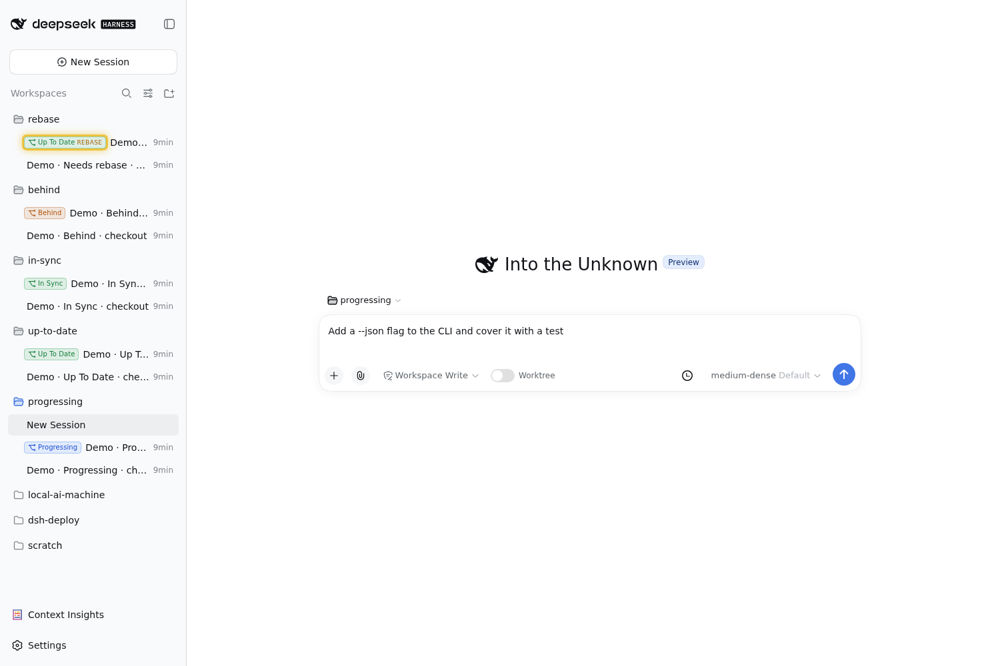
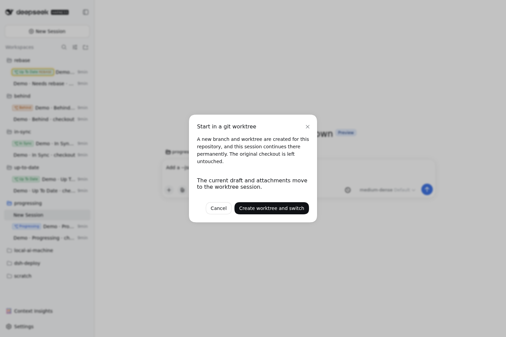
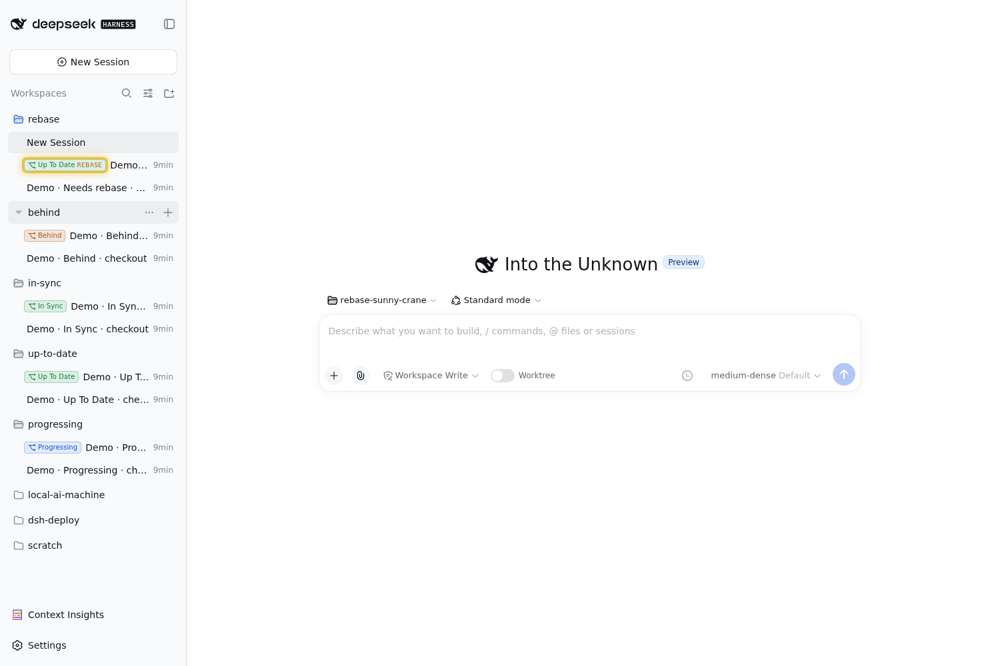
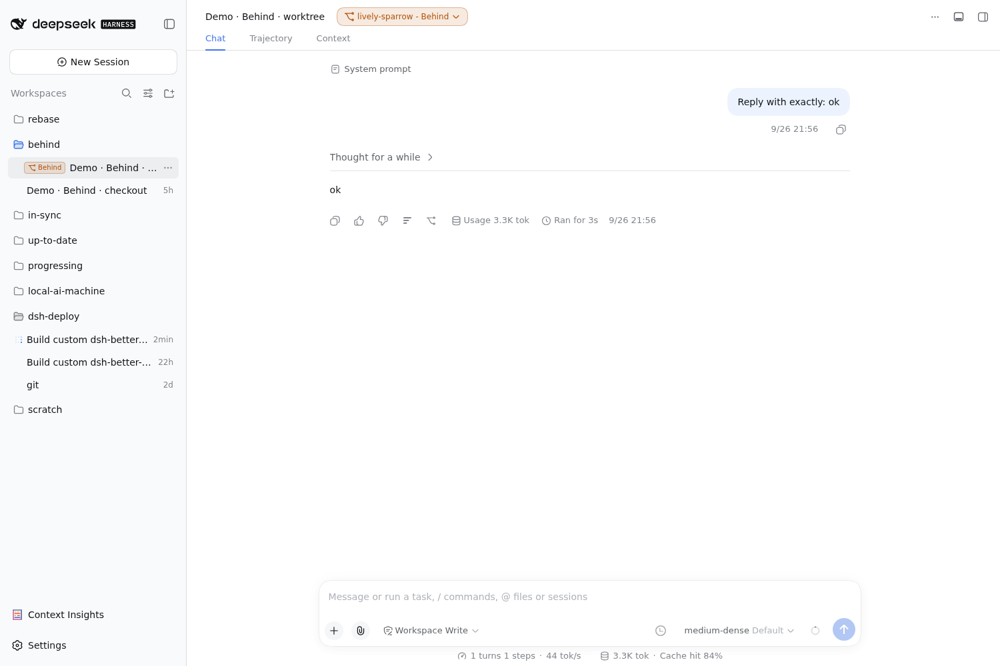
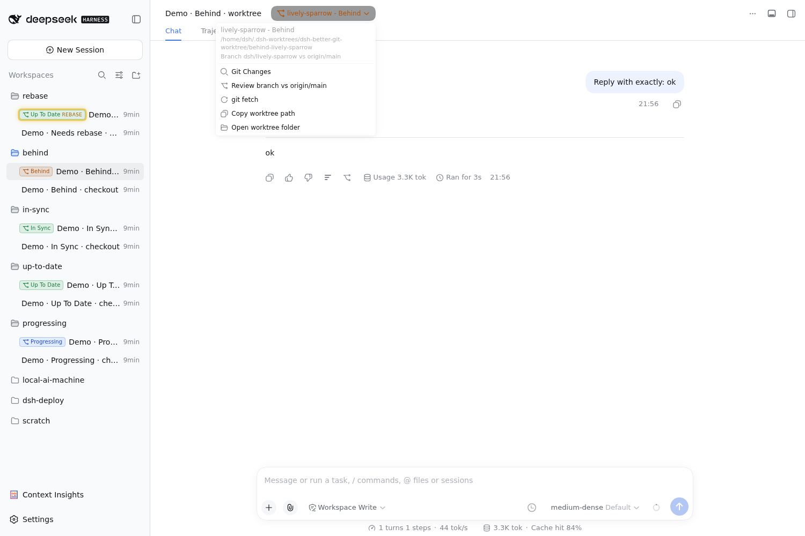
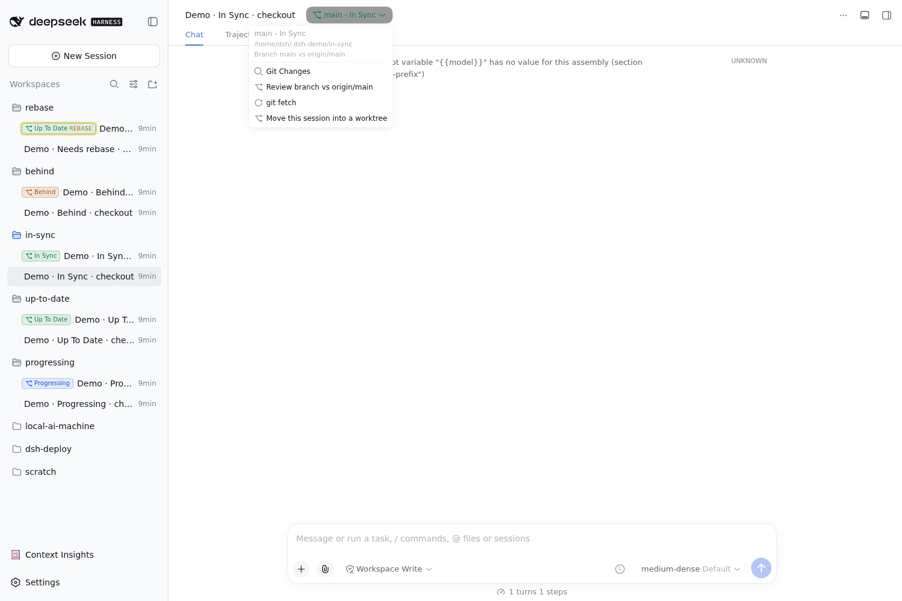
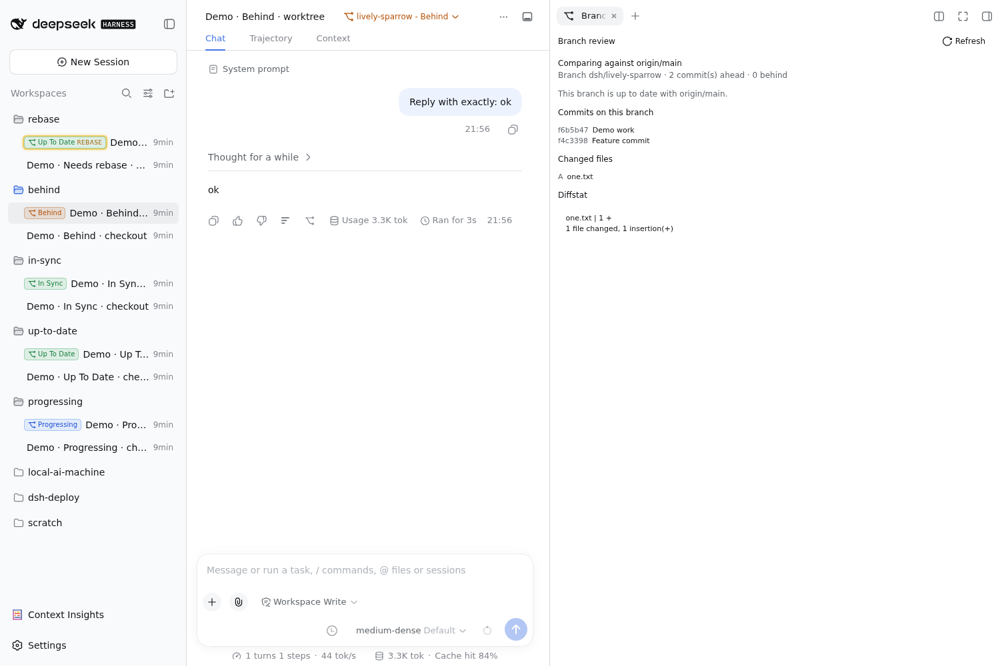
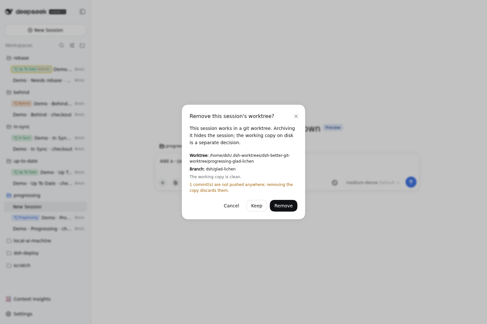

# dsh-better-git-worktree — usage guide

A session can work in its own **git worktree** for its whole life. This guide is
the operator's view: what each surface shows, what every action does, and what
the statuses mean. The design rationale (self-contained working copies, and why
the sandbox needs no escalation) lives in the plugin `README.md`.

> The screenshots below were captured on dsh 0.1.5 with the earlier, inlined
> version of this plugin. Pending retake on a 0.2.0 UI: the session-row badge is
> now an icon in the row's leading cell rather than a text pill, and
> worktree sessions are their own workspace in the sidebar.

## Gallery

Every screenshot below is captured from a running harness, one per status, with
and without a managed worktree.

### New session in a worktree



*The new-session composer holding a draft message, with sidebar status badges
Progressing, Up To Date, In Sync, Behind, and a yellow REBASE tag on the
rebase-needing branch.*



*Confirmation dialog shown when the composer is switched into a new git
worktree.*

### The session list



*Composer in a worktree workspace (chips `rebase-sunny-crane` and
`Standard mode`) with each session group showing its status badge in the
sidebar.*



*Worktree session view with the amber `lively-sparrow - Behind` header pill and
a hover tooltip over a sidebar session row.*

### The header menu



*Header-pill dropdown for a worktree session: Git Changes, Review branch vs
origin/main, git fetch, Copy worktree path, Open worktree folder.*



*Header-pill dropdown for a main-checkout session: Git Changes, Review branch vs
origin/main, git fetch, Move this session into a worktree.*

### Reviewing and retiring



*Branch-review panel comparing the worktree branch with `origin/main`
(2 commits ahead, 0 behind) with commits, changed files, and diffstat.*



*Archive-worktree dialog with the worktree path, branch, and unpushed-commits
warning; actions are Cancel, Keep, and Remove.*

## The mental model

Every session has a **checkout**: the directory it works in. For most sessions
that is the workspace directory itself. For a *worktree session* it is a managed
working copy on its own branch.

```
workspace directory            managed working copy
<repo>                 ──▶     <repo>/.dsh-worktrees/brave-otter
   (main checkout)                     branch: dsh/brave-otter
```

Everything this plugin shows — the header pill, the sidebar badge, the menu — is
about *that checkout*, and it works the same whether the session is in a managed
worktree or in the workspace directory itself. Only two things are
worktree-specific: the sidebar badge, and the actions that manage the working
copy (copy path / open folder / remove on archive).

## Surfaces

### 1. Composer switch (blank sessions only)

A **Worktree** toggle sits in the composer tool row of a brand-new session.

- Off → the session runs in the workspace directory.
- Click it → one confirmation dialog → **Create worktree and switch**.
- The branch and working copy are created immediately and the session continues
  there permanently. The toggle then reads ON and is disabled: it is a statement
  of fact, not an action.

There is no review or acceptance step later — that is the difference from
`dsh-git-worktree`.

### 2. Header pill and menu

The session header shows a pill:

```
brave-otter - Progressing        main - In Sync
```

`<name> - <status>`, coloured to match the sidebar badge:

| part | what it is |
| --- | --- |
| name | the working copy's pet name (`brave-otter`), or the branch name (`main`) when the session runs in the workspace directory |
| status | one of the statuses below |

Clicking it opens the actions:

| action | what it does |
| --- | --- |
| **Git Changes** | opens the `dsh-better-sidebar` *Changes* tab (its git lens) for this session: staged/unstaged files, per-file diffs, stage/commit |
| **Review branch vs `<ref>`** | opens this plugin's *Branch review* panel: commits and changed files against the default branch, with a **Refresh** button |
| **git fetch** | runs `git fetch` in this session's checkout. Available for every session, worktree or not |
| **Copy worktree path** | copies the managed working-copy path (worktree sessions only) |
| **Open worktree folder** | hands the working-copy folder to the desktop file manager (`xdg-open`/`gio`/`nautilus`/…, `open` on macOS, `explorer` on Windows). If the host has no opener installed the menu says so instead of pretending |
| **Move this session into a worktree** | creates a worktree for a session that does not have one, moves its uncommitted work in, and continues the conversation in a session rooted there (workspace sessions only) |

### 3. Sidebar badge (worktree sessions only)

Idle rows for worktree sessions carry a small icon in the cell before the title,
coloured by status; hovering shows the full detail in the session hover card.
A busy or pending row shows its own state dot instead and no badge. A worktree
session is its own workspace in the sidebar (named after the working copy), and
the working copy is also listed in the new-session workspace dropdown; it is
created by the composer switch, not meant to be picked there.

The session's "..." menu also offers **Copy worktree path** and **Open worktree
folder** for these sessions.

## Statuses

| Badge | Colour | Meaning | What to do |
| --- | --- | --- | --- |
| **Progressing** | blue | work is not published yet: no upstream, or commits ahead of the upstream | keep working, then `git push -u origin <branch>` |
| **Behind** | amber | the upstream has commits this branch lacks and the branch has nothing of its own | `git pull --ff-only` |
| **Up To Date** | green | exactly in step with its upstream, and the branch is not `origin/<default>` | nothing — it is pushed |
| **In Sync** | green | in step with its upstream *and* identical to `origin/<default>` | nothing — fully integrated |
| **Missing** | grey | the recorded working-copy directory is gone | archive the session and remove the worktree, or recreate it |

A **yellow glow** on the badge is a separate overlay: the branch has its own commits *and*
`origin/<default>` has moved on, so it needs rebasing. It appears on top of any
status, and the tooltip spells out how many commits behind the default branch is.

The tooltip is always the complete answer — status, upstream, working-tree
counts, comparison with the default branch, and the last commit.

## Git work inside a worktree

Each worktree session gets a self-contained working copy nested in the checkout
it came from (`<repo>/.dsh-worktrees/<pet>/`).
It owns its git database and reads the checkout's objects through an alternate,
so run git normally: `add`, `commit`, `push`, and anything that shells out to git
(flake builds, package installs, hooks) all work under the plain
`workspace-write` sandbox with no escalation, because every write lands inside
the copy.

Two things follow from that layout:

- The copy is not registered in the checkout, so `git worktree list` there does
  not show it and its branch stays local until pushed. Pushes go to the same
  `origin` as the checkout.
- Creating a copy adds `.dsh-worktrees/` to `<repo>/.git/info/exclude`. That file
  is local to the clone — no tracked file changes, no commit, nothing that can
  disturb a branch mid-flight. If the entry is missing (you removed it, or the
  copy predates it), the header menu shows **Ignore worktrees in this checkout**
  and writes it again.

## Workflows

### Start a new task in a worktree

1. New session → pick the workspace.
2. Turn on **Worktree** → **Create worktree and switch**.
3. Work as usual. The session's checkout is the working copy; the main checkout
   is untouched.
4. When the work is ready, push the branch from inside the session
   (`git push -u origin <branch>`); the pill turns green.

### Move a session that already has work in progress

1. Open the session and use **Move this session into a worktree** in the header
   menu (or ask the agent to call the `worktree_convert` tool).
2. A branch and working copy are created; the session's uncommitted work is moved
   into it.
3. The conversation continues in a session rooted in the working copy: the new
   session carries everything through the source's last completed turn, and the
   source is archived. If the source has no completed turn yet (the agent called
   the tool in the first turn of the session), there is nothing to carry: the new
   session starts blank and the source is left where it is.

The move uses `git stash` in the source checkout and replays the same change into
the working copy. The stash entry is deliberately kept as a backup and its ref is
reported in the tool result; if the replay fails, the stash is popped back.

### Review what an agent changed

- **Git Changes** — the file-level view (the sidebar's own git lens).
- **Review branch vs origin/main** — the branch-level view: commits, changed
  files, diffstat against the default branch. Hit **Refresh** after running
  **git fetch**.

### Retire a worktree session

Archiving a worktree session prompts first:

| button | what it does |
| --- | --- |
| **Cancel** | nothing happens |
| **Keep** | the session is archived; the working copy stays on disk |
| **Remove** | the working copy is deleted, the registry record is dropped, and the dead workspace registration is retired — nothing is left behind in the sidebar |

The dialog names the path and branch and warns about uncommitted paths and
unpushed commits, so **Remove** is never a surprise.

## Where things live

| what | where |
| --- | --- |
| working copies | `<repo>/.dsh-worktrees/<pet>` (nested in the checkout, one directory per pet name), falling back to `~/.dsh-worktrees/<pet>` if the checkout cannot host it |
| session → worktree registry | `$DSH_HOME/plugins/dsh-better-git-worktree/worktrees.json` |

A working copy is *self-contained*: it owns its git database (`git init` in
place) and reads the checkout's objects through `.git/objects/info/alternates`,
so nothing is duplicated and every write git makes lands inside the copy. It is
therefore not listed by the checkout's `git worktree list`, and its branch lives
in the copy until it is pushed.

Working copies created before this flat layout carry an extra path segment
(`<repo>/.dsh-worktrees/dsh-better-git-worktree/<project>-<pet>`); they still
work and are still removed by the same archive action.

## Limits worth knowing

- **A running session cannot change its checkout.** `session.header.cwd` is
  immutable creation metadata, so "convert this session" creates a session in the
  worktree and continues the conversation there.
- **The archive shortcut skips the dialog.** The row's archive button and the "..."
  menu row ask first; the keyboard shortcut calls the official archive directly and
  keeps the working copy on disk.
- **`Open worktree folder` needs a desktop opener.** On a host with no file
  manager launcher installed, use **Copy worktree path** instead — the menu
  reports the missing opener explicitly.
- **Statuses are read from local refs.** A working copy's own `git fetch`, from
  the header menu or run by the agent, is what makes "Behind"/"In Sync" and the
  rebase glow reflect the real remote. The plugin's throttled background fetch
  refreshes the source checkout, not the copies, so it does not do this for you;
  until a copy's first fetch it has no `origin` refs and no comparison with the
  default branch. (Unpushed commits are still counted without them.)
